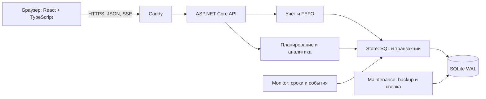

# Флагман — контроль кухни

**Флагман** — веб-приложение для управления продуктами, партиями и доступностью блюд в одном ресторане. Оно связывает поставки, рецептуры и заказы с фактическими остатками: списывает ингредиенты по сроку годности, объясняет причины стоп-листа, предлагает использовать продукты до истечения срока и рассчитывает потребность в закупках.

Стек: **C# / ASP.NET Core 8, SQLite WAL, React 19, TypeScript и SCSS**. Интерфейс и API работают на одном адресе; изменения передаются открытым клиентам через Server-Sent Events (SSE).

README обновлён для внешних заявок **15 октября 2026 года**. Реализованы складской учёт, оптимизатор продаж, закупочные цены, сценарное планирование и аналитика по календарю ресторана. График позволяет выбирать отдельные дни или диапазон и пересчитывать показатели; счётчики склада охватывают всю базу, а список предупреждений использует серверную пагинацию.

Последняя сохранённая полная локальная релизная приёмка относится к **1.2.0-rc1 от 10 октября**: 29 доменных проверок, 7 E2E и нагрузочные прогоны с пятью операторами. После неё изменились интерфейс и аналитика. В [аудите от 12 октября](docs/PRESENTATION_AUDIT_20261012.md) зафиксированы 36/36 доменных проверок, frontend-сборка и проверки исправлений А1–А5. Эти результаты не подтверждают полную приёмку текущего checkout или обновление существующего ZIP.

[План анимаций](docs/ANIMATION_IMPLEMENTATION_PLAN.md) реализован по этапам A–G; окончательная проверка производительности остаётся частичной. Docker, публичное HTTPS-демо, удалённый CI и эксплуатация на целевом хосте требуют отдельных проверок. Основания и границы: [PROJECT_AUDIT](docs/PROJECT_AUDIT.md), [HACKATHON_VERIFICATION](docs/HACKATHON_VERIFICATION.md), [проверка ошибок интерфейса](docs/BUG_AUDIT_20261011.md).

## Содержание

- [Назначение и возможности](#назначение-и-возможности)
- [Быстрый запуск](#быстрый-запуск)
- [Первое использование и демонстрация](#первое-использование-и-демонстрация)
- [Правила складского учёта](#правила-складского-учёта)
- [Рекомендации, закупки и прогноз](#рекомендации-закупки-и-прогноз)
- [Архитектура и структура проекта](#архитектура-и-структура-проекта)
- [Конфигурация](#конфигурация)
- [API и SSE](#api-и-sse)
- [Разработка и проверки](#разработка-и-проверки)
- [Docker и эксплуатация](#docker-и-эксплуатация)
- [Резервное копирование и восстановление](#резервное-копирование-и-восстановление)
- [Релизы и обновление](#релизы-и-обновление)
- [Ограничения и готовность](#ограничения-и-готовность)
- [Типичные проблемы](#типичные-проблемы)
- [Документация](#документация)

## Назначение и возможности

На кухне важно знать не только общий остаток продукта, но и происхождение каждой партии, её срок годности и количество порций, которое можно приготовить. Один продукт может входить в несколько блюд, а продукты из разных поставок — иметь разные сроки хранения.

Флагман помогает управляющему понять, какие партии использовать первыми, можно ли приготовить весь заказ, почему блюдо недоступно и что заказать у поставщика. История позволяет отличать расход на продажи от потерь по сроку годности.

Рабочий цикл: **продукты → рецептуры → поставка → партии → заказ → расход → обновлённый стоп-лист и планирование**.

| Раздел интерфейса | Возможности |
|---|---|
| Обзор кухни | Сводка склада, заказы по дням, дефицит и потери, ближайшие сроки и начальная настройка пустой базы |
| Склад и партии | Поиск по всей базе, фильтры статуса, сортировка по срокам, страницы и происхождение партии |
| Поставки | Приём продуктов с количеством и сроком, просмотр состава сохранённой поставки |
| Меню и рецептуры | Каталог, расход на порцию, новые версии проданных блюд, архивирование |
| Заказы | Несколько блюд одной операцией, принятие или конкретная нехватка ингредиентов |
| Стоп-лист | Недоступные блюда и причины нехватки запаса на одну порцию |
| Сроки годности | Близкие сроки и истёкшие партии, поиск и страницы полного списка предупреждений |
| Горячие предложения | Рейтинг блюд, конкретные партии, совместный план и переход к заказу |
| Закупки | Недостающие объёмы с учётом спроса, доставки и страхового запаса |
| Прогноз | Сценарный интервал недоступности с учётом расписания и сроков |
| Аналитика | Период в часовом поясе ресторана, выбор дней на графике, отказы по блюдам и ингредиентам, расход и потери, стоимость по валютам |
| Демонстрация | Учебные данные, сдвиг времени и воспроизводимый генератор |

Разделы имеют отдельные URL; переходы назад и вперёд работают через историю браузера. Для склада адрес сохраняет поиск и фильтр. Интерфейс адаптируется к мобильной ширине. При потере связи показывает переподключение и время последней проверки. Подробнее: [руководство управляющего](docs/OPERATOR.md).

## Быстрый запуск

### Требования

Для сборки нужны **Node.js 22+**, npm и **.NET 8 SDK**. Windows-скрипты используют PowerShell. Docker и Docker Compose нужны только для контейнерного запуска.

Готовый publish-артефакт требует ASP.NET Core 8 Runtime или .NET 8 SDK; Node.js на таком сервере не нужен.

Windows-скрипты выбирают `.tools/dotnet/dotnet.exe`, если локальный SDK присутствует, иначе используют `dotnet` из `PATH`. Каталог `.tools` исключён из Git и может отсутствовать в свежем клоне.

### Windows / PowerShell

Из корня репозитория задайте собственный пароль длиной не менее 10 символов:

```powershell
$env:FLAGMAN_PASSWORD = 'replace-with-your-private-password'
.\scripts\start.cmd
```

Откройте [http://127.0.0.1:5080](http://127.0.0.1:5080) и войдите с логином `manager` и заданным bootstrap-паролем. На новой базе приложение покажет начальные шаги настройки.

Скрипт устанавливает зависимости через `npm ci`, если `node_modules` отсутствует, собирает frontend в `backend/wwwroot` и запускает API в режиме `Development`. Сервер отдаёт и страницу, и `/api`.

Для демонстрации:

```powershell
$env:FLAGMAN_PASSWORD = 'replace-with-your-private-password'
.\scripts\start.cmd -Demo
```

После входа нажмите **«Загрузить демо»**. Для другого порта используйте `-Port 5081`.

Демо-поставки и генератор используют условные закупочные цены в RUB, чтобы показывать стоимость расхода и списаний. При перезапуске в демо-режиме пропущенные цены ранее созданных демо-партий заполняются автоматически; известные цены и ручные поставки сохраняются.

Демо также включает шесть дней истории: 24 принятых заказа всего основного меню, отказы из-за дефицита и списания остатков с известной стоимостью. Этого достаточно для расчёта спроса по истории, прогнозов и денежного плана продаж. В демо-закупках срок хранения по умолчанию — 48 часов, поэтому оценка избытка рассчитывается сразу; срок и учебные цены переносятся в черновик поставки. Избыток — количество, ожидаемое к истечению срока, а не процент вероятности. Старое демо дополняется один раз при запуске или повторной загрузке демо без сброса текущих остатков. После длительного сдвига времени история может выйти за выбранное окно спроса; для нового сценария используйте ручной спрос или сброс демо.

| Запуск через скрипт | База по умолчанию |
|---|---|
| Без `-Demo` | `backend/data/production/flagman.db` |
| С `-Demo` | `backend/data/demo/flagman.db` |

Повторный запуск сохраняет данные. `FLAGMAN_DB` переопределяет оба пути: перед переключением режима проверьте её значение. Старую базу `backend/data/flagman.db` скрипт не изменяет.

Для сброса остановите сервер (`Ctrl+C` в терминале запуска) и выполните одну команду из корня проекта:

```powershell
.\scripts\reset-db.cmd               # Очистить обычную базу
.\scripts\reset-db.cmd -Demo         # Вернуть стандартные демо-данные
.\scripts\reset-db.cmd -Demo -Empty  # Очистить демо-базу без загрузки данных
```

Путь выбирается как при запуске: `FLAGMAN_DB`, если задана, иначе `backend/data/production/flagman.db` или `backend/data/demo/flagman.db` с `-Demo`. Для конкретного файла используйте `-Database 'D:\FlagmanData\flagman.db'`; этот параметр имеет приоритет над `FLAGMAN_DB`. `-Demo` также выбирает загрузку демо-набора, а `-Empty` отменяет её.

Команда автоматически собирает Maintenance через .NET 8 SDK, сохраняет проверенную копию существующей базы рядом с ней (`flagman.db.before-reset-*.db`) и сбрасывает все данные и настройки одной транзакцией. Демо-время обнуляется, сроки демо-партий отсчитываются от момента сброса. Копии сохраняются до ручного удаления. После сброса запустите приложение прежней командой; для демо используйте `start.cmd -Demo` — демо-набор уже загружен.

`start.cmd` использует `ExecutionPolicy Bypass` только для дочернего процесса, не меняя системную политику. Эквивалент:

```powershell
powershell.exe -NoProfile -ExecutionPolicy Bypass -File .\scripts\start.ps1 -Demo
```

### Linux / macOS

Из корня репозитория соберите frontend и запустите API:

```bash
cd frontend
npm ci
npm run build
cd ..

export FLAGMAN_PASSWORD='replace-with-your-private-password'
export FLAGMAN_DB="$PWD/backend/data/demo/flagman.db"
export FLAGMAN_DEMO=true
export ASPNETCORE_ENVIRONMENT=Development
dotnet run --project backend/Flagman.Api.csproj --urls http://127.0.0.1:5080
```

Для работы без демо задайте `FLAGMAN_DEMO=false` и отдельную БД, например `backend/data/production/flagman.db`. Скрипты автоматической приёмки и эксплуатации ориентированы на PowerShell.

## Первое использование и демонстрация

### Работа с пустой базой

1. **Создайте продукты:** название, базовая единица (`g`, `ml` или `pcs`), порог предупреждения о сроке.
2. **Создайте блюда:** ингредиенты и количество каждого продукта на одну порцию.
3. **Примите поставку:** номер, состав, количества и сроки; каждая строка создаёт отдельную партию.
4. **Проверьте меню:** блюдо доступно, когда пригодного остатка хватает на одну порцию по всем ингредиентам.
5. **Оформите заказ:** система либо спишет весь состав, либо сохранит отказ без частичного расхода.
6. **Откройте историю:** проверьте результат заказа, использованные партии и движения.
7. **Настройте планирование:** часовой пояс, окно спроса, срок доставки и горизонт закупок.

Для повторного знакомства с пустым проектом выбирайте новый файл БД. Рабочий склад не следует очищать ради демонстрации.

### Сценарий на 5–7 минут

Для новой демонстрации задайте ещё не использованный путь:

```powershell
$env:FLAGMAN_PASSWORD = 'replace-with-your-private-password'
$env:FLAGMAN_DB = Join-Path (Get-Location) 'backend\data\demo-session-2\flagman.db'
.\scripts\start.cmd -Demo
```

1. Загрузите демо: появятся партии томатов с разными сроками и Цезарь в стоп-листе из-за нехватки романо.
2. Закажите Капрезе и пасту. Покажите общую потребность в томатах и расход ранней партии.
3. Попробуйте заказать Цезарь: отказ объяснит нехватку, остальные ингредиенты останутся на складе.
4. Примите поставку романо и покажите выход блюда из стоп-листа.
5. Сравните рейтинг предложений и совместный план, посмотрите конкретные партии и часы до истечения.
6. Откройте второй клиент: оба обновятся после поставки или заказа через SSE.
7. Сдвиньте время на 24 часа: просроченные партии станут недоступны для приготовления и будут выделены красным. Физический остаток сохранится. Нажмите «Списать товар», укажите причину и подтвердите: появятся списание и потери. Любую партию с положительным остатком можно списать и до истечения срока.
8. Запустите генератор с `seed=42`, затем остановите его. Повторный запуск продолжает последовательность; раскройте «Журнал событий генератора» для проверки состава и результатов, открытия заказов и поставок. Для независимой последовательности используйте новый seed.

Повторная загрузка seed безопасна: ранее созданные события не применяются заново. Время сдвигается только вперёд, максимум на 720 часов за запрос. Рабочий режим отвергает базу с ненулевым демо-сдвигом. Подробнее: [docs/DEMO.md](docs/DEMO.md).

## Правила складского учёта

### Продукты, партии и движения

**Продукт** задаёт наименование и единицу. **Партия** — конкретное поступление со своим исходным и текущим количеством, временем приёмки и сроком. **Движение** фиксирует изменение количества партии.

| Вид движения | Знак | Причина |
|---|---|---|
| `receipt` | Положительный | Поступление партии |
| `order` | Отрицательный | Расход на принятый заказ |
| `expiry` | Отрицательный | Списание остатка по сроку |

Контрольная сверка проверяет, что сумма движений каждой партии точно равна её остатку. Количества сохраняют decimal-точность; разные единицы не складываются в общий физический объём.

Базовые единицы — граммы (`g`), миллилитры (`ml`) и штуки (`pcs`). При поставке kg переводятся в g, l — в ml. Несовместимые единицы отклоняются. Вводимое количество должно быть положительным, не более 1 млрд и иметь до трёх знаков после запятой. Рецептура задаёт расход на порцию в базовых единицах продукта.

### Срок годности и время

Для строки поставки можно указать:

- `expiresAt` — точный момент истечения;
- `expiryDate` — дату, до конца которой продукт пригоден в часовом поясе ресторана;
- `shelfLifeHours` — длительность от `manufacturedAt`, а без даты производства — от времени отправки поставщиком. Абсолютный срок сохраняется до приёмки.

`expiresAt` и `expiryDate` нельзя передавать одновременно. Производство не может быть позже приёмки, а приёмка и создание поставки — в будущем. Срок должен быть позже приёмки.

При `now >= expiresAt` партия исключается из пригодного запаса, сохраняя физический остаток. Monitor обновляет статус и доступность примерно раз в секунду; остаток списывает менеджер явной командой.

Время хранится в UTC. Формы используют часовой пояс ресторана, по умолчанию `Europe/Moscow`, независимо от пояса компьютера. Дата без времени означает границу начала следующего дня в этом поясе. Формы отклоняют неоднозначное или отсутствующее время при переходе DST.

### FEFO и атомарный заказ

FEFO (*First Expired, First Out*) означает: первой расходуется партия, которая раньше потеряет годность. При одинаковом сроке порядок задают время приёмки и ID партии.

Например, есть 2 кг томатов с ранним сроком и 3 кг с поздним. Заказ требует 2,5 кг: из первой партии уйдут 2 кг, из второй — 0,5 кг.

Система суммирует потребность **всех блюд заказа**. Если два блюда используют томаты, доступность каждой позиции отдельно ещё не гарантирует доступность сочетания. При нехватке хотя бы одного ингредиента сохраняется заказ `rejected`, а расход остальных не выполняется.

### Повторы и исторические рецептуры

Поставки и заказы используют `Idempotency-Key`. Повтор того же запроса с тем же ключом возвращает сохранённый результат; другой состав с использованным ключом даёт `409`. Сохраняется и отказ: после новой поставки для новой попытки заказа нужен новый ключ.

Перед отправкой интерфейс сохраняет состав и ключ незавершённой операции в `localStorage`. После потери ответа или перезагрузки он может проверить результат и повторить исходный запрос, предотвращая двойное списание.

Рецептуру блюда, участвовавшего в принятом заказе, менять нельзя: создайте новую версию. Архивирование сохраняет историю. Продукт нельзя архивировать, пока он входит в активное блюдо.

## Рекомендации, закупки и прогноз

### Горячие предложения

Рейтинг по одной порции показывает срочность. Совместный план рассчитывается отдельно по кнопке: начало/горизонт 6/12/24 часа или конец смены, спрос, время приготовления и ёмкость кухни. Выберите ручные лимиты, достаточную историю или только ограничения склада. Без истории продаваемость не заявляется.

SalesPlanner распределяет целые порции с общим FEFO-запасом и сроками в момент готовности. Цель — нормированные доли рисковых партий × срочность; единицы не складываются. При полных ценах доступен отдельный денежный режим в выбранной валюте. Малые пространства перебираются точно; при бюджете времени/узлов или большом размере возвращается допустимое приближение не хуже базового плана. Статус оптимальности, причина остановки, время, исходный/остаточный риск и технический предел 10000 порций на блюдо показаны явно. Формулы: [HACKATHON_DECISIONS](docs/HACKATHON_DECISIONS.md).

«Создать заказ по плану» переносит все блюда и порции в форму; «В заказ» переносит строку с её количеством. Серверный FEFO-предпросмотр не меняет склад. Подтверждение выполняет обычную атомарную проверку по текущим остаткам; устаревший план может получить отказ. Планы со временем приготовления являются расписанием; общий заказ проверяет весь состав на приготовление сейчас. Кэш расчёта ограничен revision, параметрами и ближайшей временной границей, до 30 секунд; SSE не запускает оптимизатор каждую секунду.

### Закупки, прогноз и аналитика

Закупки и прогноз используют общий ScenarioDemand: рабочие дни/часы ресторана, сглаженный профиль времени суток/дня недели, минимум дней с наблюдениями/заказов, ручной fallback и сценарии низкого/обычного/высокого спроса 60/100/140%. Это сценарии, а не доверительные интервалы. Включение уникальных отказов в модель — явная отключённая по умолчанию гипотеза. Повторы одного Idempotency-Key не добавляют спрос.

Весь активный каталог участвует в общей потребности. Прогноз учитывает FEFO, истечение, закрытые часы и только явно заданные будущие поставки. Причина содержит конкретный продукт; момент показывается интервалом шага до 15 минут. При недостаточной истории расход не выдумывается: доступны ручной сценарий или расчёт только сроков.

Закупки моделируют расход до приезда, пригодный остаток, истечение внутри горизонта и совместную потребность после доставки с safetyFactor. Один расход не вычитается дважды. Количество/доставку/срок закупки можно изменить и проверить вероятный остаток к сроку через FEFO. Без спроса или срока избыток неизвестен; сценарный срок поддержан до 720 часов. Черновик переносится в редактируемую поставку, требует явных времени и срока и не создаёт движений. Предпросмотр показывает доступность сейчас/к приезду/после.

Закупочная цена партии необязательна и задаётся за единицу строки и валюту RUB/USD/EUR. kg/l делят цену на 1000 вместе с переводом количества в g/ml. Старые цены неизвестны. Стоимость фактических заказов и списаний рассчитывается по movements и исторической цене соответствующей партии, валюты и полнота цен показаны раздельно. Сценарный эффект плана не выдаётся за доказанную экономию.

Старые поля procurement/forecasts/salePlan в /snapshot сохранены как совместимый базовый API; интерфейс новых расчётов использует /planning и /scenario с явными параметрами. Доказательства, неудачные случаи и границы: [HACKATHON_VERIFICATION](docs/HACKATHON_VERIFICATION.md).

Аналитика включает полные календарные дни в часовом поясе ресторана, в том числе дни перехода на летнее/зимнее время. График показывает весь выбранный период с горизонтальной прокруткой. Клик выбирает дни, Shift + клик или кнопка «Диапазон» — диапазон; «Все дни» сбрасывает фильтр. Выбор пересчитывает показатели, рейтинги и таблицы. Обновление через SSE сохраняет применённый период.

Рейтинг дефицита считает уникальные отказы в заказах; он не измеряет длительность стоп-листа. Есть топ блюд по отказам и топ продуктов по стоимости списаний отдельно в каждой валюте. Потери относятся к дате проведения списания. Суммы учитывают известные закупочные цены; полнота цен расхода и потерь показана отдельно. Неизвестная цена не означает нулевую стоимость.

## Архитектура и структура проекта

Приложение состоит из одного API-процесса, браузерного клиента и локальной SQLite-базы. В контейнерном профиле HTTPS завершает Caddy.



При локальном запуске браузер обращается к API напрямую, Caddy не нужен.

| Слой | Технологии и роль |
|---|---|
| Backend | C#, .NET 8, ASP.NET Core Minimal API; авторизация, JSON и SSE |
| Хранилище | SQLite WAL, Microsoft.Data.Sqlite; `BEGIN IMMEDIATE`, индексы и decimal-значения в JSON payload |
| Frontend | React 19, TypeScript 5.7, Vite 6, SCSS, lucide-react |
| Дизайн | Токены из `theme.json`, генерация CSS перед сборкой, адаптивные формы |
| Фоновые задачи | Monitor для сроков и Generator для демо |
| Проверки | C# executable с assertions, Playwright, axe, smoke/config/load-скрипты |
| Развёртывание | Многоэтапный Dockerfile, Compose и Caddy 2 |

Java и Go упоминаются в исходных материалах как альтернативы backend. Текущей реализации они не нужны.

### Хранение и согласованность

Каталог, поставки, партии, заказы, движения, отказы, события, результаты повторов и аудит хранятся в отдельных таблицах с ID и JSON payload. Метаданные содержат настройки, ревизию и демо-сдвиг. Текущая схема — **v3** (необязательные цены и календарь; предварительная SQLite-копия v1/v2).

Запись защищают транзакции и очередь одного API-процесса. Изменение склада, результат идемпотентной операции и событие фиксируются согласованно. Специализированные SQL-выборки и индексы уменьшают чтение для склада, истории и FEFO.

Snapshot ограничивает коллекцию партий 500 записями, начиная с активных, и журналы 100 записями. При этом `totals.activeBatches` и `totals.warningBatches` считаются по всей базе; пять ближайших сроков выбираются отдельно. Полный склад и список предупреждений доступны через SQL-пагинацию и серверный поиск. Аналитика выбранного периода не ограничена этой коллекцией snapshot.

### Сессии и защита запросов

Раздельные аккаунты admin/manager/supplier/waiter/cook. Администратор имеет полный доступ, включая «Аккаунты» и «Демонстрация»; менеджер работает с операционными разделами без управления аккаунтами, API-ключами и демонстрацией. При обновлении до схемы v5 прежние менеджеры однократно становятся администраторами с сохранением логина и пароля; требуется повторный вход, старые API-ключи нужно перевыпустить. Перед миграцией создаётся резервная копия базы. Новые аккаунты manager сохраняют ограниченную роль при перезапусках. `FLAGMAN_PASSWORD` создаёт первого администратора (логин manager) только при отсутствии аккаунтов; страницы используют cookie, внешние интеграции — отзываемые bearer API-ключи. Cookie `flagman.session` имеет `HttpOnly`, `SameSite=Strict` и в Production требует HTTPS. Сессия действует до 8 часов без автоматического продления.

Запись требует `X-Requested-With: Flagman`; переданный `Origin` должен совпадать с адресом приложения. Вход ограничен 10 попытками на IP в минуту. Максимальное тело запроса — 128 КиБ.

Data Protection keys сохраняются в `keys` рядом с БД. Изменение роли, пароля или active аккаунта инвалидирует cookie и API-ключи через sessionVersion без перезапуска. Авторство операций связано со стабильным account ID.

### Каталоги и файлы

```text
backend/
  Program.cs                  HTTP API, сессии, SSE и конфигурация
  Models.cs                   Сущности и настройки
  Inventory.cs                Поставки, FEFO, заказы и истечение
  Insights.cs                 Рекомендации, закупки, прогноз, аналитика
  SalesPlanner.cs             Совместный план продаж и оптимизация
  ScenarioDemand.cs           Календарь, спрос, закупки и прогноз сценария
  PlanningService.cs          Расчёт плана, кэш и предпросмотры операций
  Store.cs                    SQLite, миграции, выборки и транзакции
  Workers.cs                  Monitor и демо-генератор
  Telemetry.cs                Метрики и состояние фонового контроля
frontend/
  src/                        React-интерфейс, формы и страницы
  src/WarehouseDashboard.tsx  Обзор склада и ближайшие действия
  src/AnalyticsView.tsx       Периоды, фильтры дней и рейтинги аналитики
  src/OrdersChart.tsx         Интерактивный график заказов
  src/OffersView.tsx          Горячие предложения и план продаж
  src/PlanningView.tsx        Сценарные закупки и прогноз
  src/motion/                Присутствие, диалоги и reduced motion
  src/useCalculation.ts      Отмена и защита от устаревших расчётов
  src/api.ts                  API-клиент и восстановление операций
  src/time.ts                 Работа со временем ресторана
  src/tokens/                 Исходные токены и генерируемый CSS
  e2e/                        Браузерные сценарии
  vite.config.ts              Сборка в backend/wwwroot и dev proxy
  playwright.config.ts        Настройки браузерных проверок
tests/                        Доменные и SQLite-проверки на C#
tools/Flagman.Maintenance/     Backup, restore и проверка целостности
tools/design/                 Генерация токенов и проверки дизайна
scripts/                      Запуск, приёмка, нагрузка и упаковка
deploy/                       Конфигурации Caddy
docs/                         Руководства, решения и отчёты
.github/workflows/            Подготовленный CI
compose.yaml                  Локальный контейнерный HTTPS
compose.production.yaml       Профиль публичного домена
Dockerfile                    Многоэтапная сборка
```

`backend/data`, `backend/wwwroot`, `.tools`, `node_modules`, `test-results`, `output` и `.env` исключены из Git. Это данные, зависимости и результаты сборки, которые могут отсутствовать после клонирования.

## Конфигурация

### Переменные окружения

| Переменная | Назначение |
|---|---|
| `FLAGMAN_PASSWORD` | Bootstrap-пароль первого manager, минимум 10 символов |
| `FLAGMAN_DB` | Путь к SQLite; при прямом запуске по умолчанию `data/flagman.db` относительно content root backend; скрипт разделяет demo и production |
| `FLAGMAN_DEMO` | Только строка `true` включает демо; по умолчанию отключено |
| `FLAGMAN_SESSION_VERSION` | Версия для отзыва сессий, по умолчанию `1` |
| `FLAGMAN_TRUSTED_PROXY` | IP доверенного proxy; в Compose — `172.28.0.10` |
| `FLAGMAN_DOMAIN` | DNS-домен production-конфигурации Caddy |
| `FLAGMAN_BACKUP_DIR` | Каталог для оценки возраста копий; по умолчанию `backups` рядом с БД |
| `ASPNETCORE_ENVIRONMENT` | `Development` для локального HTTP; Production требует HTTPS для cookie |
| `ASPNETCORE_URLS` | Адрес прослушивания; в контейнере `http://+:8080`; локальные примеры используют `--urls` |
| `BASE_URL` | Адрес E2E-сервера, по умолчанию `http://127.0.0.1:5080` |
| `PLAYWRIGHT_BROWSERS_PATH` | Необязательный путь установки браузеров Playwright |
| `FLAGMAN_BROWSER` | Необязательный путь к браузеру для E2E |

`.env.example` — шаблон для Docker Compose. Скрипты локального запуска не загружают `.env` автоматически: задайте переменные в окружении процесса.

### Настройки ресторана

Настройки сохраняются в БД и изменяются через интерфейс или `PUT /api/settings`.

| Поле | По умолчанию | Влияние |
|---|---|---|
| `timezone` | `Europe/Moscow` | Локальные даты |
| `warningHours` | `48` | Общий порог близкого срока |
| `demandWindowDays` | `7` | Окно истории принятых заказов |
| `planningHours` | `48` | Горизонт закупок |
| `leadTimeHours` | `12` | Время до поставки |
| `safetyFactor` | `0.2` | Страховой запас 20% |
| `forecastHours` | `168` | Горизонт прогноза 7 суток |

У продукта есть отдельный `warningHours`. Для срочных предложений используется меньший из продуктового и общего порогов.

## API и SSE

Базовый путь — `/api`, формат — JSON с полями в `camelCase`. Для защищённых маршрутов нужна cookie-сессия; для записи — `X-Requested-With: Flagman`. Тела запросов и дополнительные примеры: [docs/API.md](docs/API.md).

| Метод и маршрут | Назначение |
|---|---|
| `GET /api/live` | Проверка процесса без авторизации |
| `GET /api/ready`, `GET /api/health` | Проверка соединения и схемы без авторизации |
| `POST /api/login` | Вход по `{ "password": "..." }` |
| `GET /api/session`, `POST /api/logout` | Проверка и завершение сессии |
| `GET /api/snapshot` | Склад, меню, расчёты, ревизия и сводки |
| `POST /api/products`, `POST /api/dishes` | Сохранение каталога |
| `POST /api/deliveries`, `POST /api/orders` | Поставка и заказ с обязательным `Idempotency-Key` |
| `GET /api/operations/{scope}/{key}` | Сохранённый результат; scope — `order` или `delivery` |
| `GET /api/history/{entity}` | Журнал `batches`, `deliveries`, `orders` или `movements`; страницы, поиск и фильтры |
| `GET /api/details/{entity}/{id}` | Подробности и связанные данные |
| `POST /api/archive/{entity}/{id}` | Архивирование `products` или `dishes` |
| `GET /api/analytics` | Аналитика по моментам `from/to` или календарным датам ресторана `fromDate/toDate`; полный дневной ряд, фильтр `days` |
| `POST /api/planning` | Явный совместный план и сравнение алгоритмов, без записи склада |
| `POST /api/scenario` | Общий сценарий спроса, прогноз и закупки |
| `POST /api/orders/preview` | FEFO-предпросмотр без заказа и движений |
| `POST /api/deliveries/preview` | Доступность сейчас/к приезду/после на копии |
| `PUT /api/settings` | Полный объект настроек |
| `GET /api/events` | SSE-поток |
| `GET /api/ops/status` | Monitor, SSE-клиенты и возраст копий |
| `POST /api/demo/seed`, `POST /api/demo/time` | Демо-данные и сдвиг; только при включённом демо |
| `GET /api/generator`, `POST /api/generator/start`, `POST /api/generator/stop` | Состояние и управление генератором; запуск только в демо |

Пример тела заказа:

```json
{
  "items": [
    { "dishId": "caprese", "portions": 2 },
    { "dishId": "pasta", "portions": 1 }
  ]
}
```

ID блюд должны существовать в каталоге. Ключ идемпотентности — строка длиной 1–100 символов, уникальная для новой операции в своей области. Журналы используют `page` и `size`; размер страницы — 1–100.

Пример аналитики: `/api/analytics?fromDate=2026-10-01&toDate=2026-10-13`. Обе даты включаются целиком по `settings.timezone`; их нельзя смешивать с `from/to`. Необязательный `days=2026-10-01,2026-10-03` выбирает дни внутри периода и применяется к заказам, расходу, потерям и дефициту.

Основные статусы: `201` — принятый заказ; `422` — сохранённый отказ с нехваткой; `400` — неверный ввод; `401` — нужна сессия; `403` — запрещённый запрос; `409` — конфликт; `429` — лимит входа. При `503` из-за занятости SQLite или потере ответа проверьте результат и сохраните прежний ключ повтора.

Каждое SSE-подключение получает `sync` с ревизией, затем `change` с ID, типом и временем. Heartbeat и проверка событий выполняются примерно раз в секунду. Клиент перечитывает snapshot после синхронизации или изменения; `Last-Event-ID` продолжает чтение после курсора.

Outbox хранит примерно последние 10 000 событий. Начальный `sync` позволяет восстановить состояние даже со старым курсором. Результаты идемпотентных операций не удаляются.

## Разработка и проверки

### Режим разработки

Для разработки с обновлением React-интерфейса запустите backend и Vite в отдельных терминалах:

```powershell
# Первый терминал, корень репозитория
$env:FLAGMAN_PASSWORD = 'replace-with-your-private-password'
$env:FLAGMAN_DB = Join-Path (Get-Location) 'backend\data\dev\flagman.db'
$env:FLAGMAN_DEMO = 'true'
$env:ASPNETCORE_ENVIRONMENT = 'Development'
dotnet run --project backend/Flagman.Api.csproj --urls http://127.0.0.1:5080
```

```powershell
# Второй терминал, корень репозитория
Set-Location frontend
npm.cmd ci
npm.cmd run dev
```

Откройте адрес, показанный Vite. Proxy направляет `/api` на `http://127.0.0.1:5080`; при смене порта обновите `frontend/vite.config.ts`.

Исходник дизайн-токенов — `frontend/src/tokens/theme.json`. `npm run build` сначала генерирует `theme.css`, затем проверяет TypeScript и запускает Vite. Генерируемый CSS обновляйте через исходные токены.

### Доменные проверки и сборка

```powershell
powershell.exe -NoProfile -ExecutionPolicy Bypass -File .\scripts\test.ps1
```

Скрипт запускает C#-проверки и frontend-сборку. Браузерные сценарии отдельно автоматически не стартуют. Если зависимости не установлены, сначала выполните `npm ci` в `frontend`.

Проверки используют временные реальные SQLite-базы и управляемое время. Покрывают FEFO, общий ингредиент, атомарность, конкурентные соединения, повторы, конфликты, перезапуск, истечение, рекомендации, закупки, прогноз и генератор. Runner — executable с assertions; ошибка возвращает ненулевой exit code.

### Браузерные проверки

Запустите выделенный сервер с новой демо-базой. В терминале тестов задайте тот же пароль:

```powershell
$env:FLAGMAN_PASSWORD = 'same-private-password-as-test-server'
$env:BASE_URL = 'http://127.0.0.1:5080'
Set-Location frontend
npm.cmd ci
npx.cmd playwright install chromium
npm.cmd run test:e2e
```

При использовании локального каталога браузеров задайте `PLAYWRIGHT_BROWSERS_PATH` одинаково при установке и запуске. Playwright не поднимает сервер сам. Тесты изменяют данные и демо-время: рабочая база для них не подходит. Результаты — в `test-results/browser`; единая приёмка также сохраняет снимки экранов.

### Единая релизная приёмка

```powershell
powershell.exe -NoProfile -ExecutionPolicy Bypass -File .\scripts\verify-release.ps1
```

Проверка создаёт случайный пароль, отдельные БД, свободные порты и свои процессы. Собирает publish-артефакт, проверяет домен, интерфейс, production-конфигурацию, onboarding без демо, потерю ответа, backup/restore и нагрузку. Логи и результаты — в `test-results/release-*`.

Параметры:

- `-SkipBrowser` — исключить браузер; запуск не считается полной приёмкой;
- `-ActiveBatches 10000` — увеличить число активных партий;
- `-Operators 5` — проверить конкурентных операторов записи.

Приёмка останавливает свои процессы и не использует рабочий сервер. После прерывания терминала проверьте оставшиеся дочерние процессы.

### CI

Workflow в `.github/workflows` описывает Windows-проверку на .NET 8 и Node 22 с Playwright, сохранение evidence и последующую сборку образа на Ubuntu. В сохранённом отчёте удалённый запуск workflow не подтверждён. Наличие CI-конфигурации не означает успешную контейнерную приёмку.

## Docker и эксплуатация

Есть два профиля Compose. Команды описывают подготовленную конфигурацию; контейнерный путь нужно проверить на Docker-хосте по [RUNBOOK](docs/RUNBOOK.md).

Dockerfile копирует `tools/design/build-tokens.mjs` в стадию `ui` до `RUN npm run build`, чтобы frontend мог выполнить генерацию темы в `prebuild`. Полная контейнерная сборка и успешный Docker-запуск здесь не подтверждены.

### Локальный HTTPS

```powershell
Copy-Item .env.example .env
# Укажите собственный FLAGMAN_PASSWORD в .env.
docker compose up --build -d
docker compose ps
```

Адрес: [https://localhost:8443](https://localhost:8443). Порт привязан к loopback. Caddy использует внутренний сертификат; для доверенного HTTPS добавьте его корневой CA в локальное доверенное хранилище.

API слушает 8080 внутри сети и не публикуется напрямую. База и ключи — в volume `flagman-data`, данные Caddy — в отдельных volumes.

### Публичный домен

В `.env` задайте приватный пароль и `FLAGMAN_DOMAIN`. Настройте DNS на хост и доступ к портам 80/443:

```powershell
docker compose -f compose.production.yaml up --build -d
docker compose -f compose.production.yaml ps
docker compose -f compose.production.yaml logs --tail 100
```

Production-профиль отключает демо и использует отдельный volume `production-data`. Proxy запускается после healthcheck API. Процесс приложения работает под UID `1654`; volume должен быть доступен этому пользователю.

Перед пилотом проверьте HTTPS и cookie, SSE двух клиентов, сохранность после рестарта, backup при записи, restore в новый volume и откат совместимой пары приложения и БД. Сборка образа не заменяет эти проверки.

### Render Free: временное демо и проверка через backend

Render Free подходит для временного демо с допустимой потерей данных. По [документации Render](https://render.com/docs/free), сервис засыпает после 15 минут без входящего трафика; локальные файлы, включая SQLite и ключи сессий, теряются при засыпании, рестарте и новом деплое. Постоянный диск на Free недоступен. Путь `/data/flagman.db` сам по себе не делает хранилище постоянным. Для рабочих данных текущему приложению нужен постоянный диск на другом тарифе или подходящий сервер; подключение внешнего PostgreSQL потребует изменения backend.

Настройки Web Service в Render:

1. Подключите репозиторий, выберите **Language: Docker**, **Dockerfile Path: ./Dockerfile**, корень репозитория как build context. Docker Command оставьте пустым: запуск задан в образе. Образ включает frontend и backend, отдельный Static Site не требуется.
2. В **Environment** задайте переменные из таблицы ниже. Файл `.env` загружать в Git не нужно.
3. В **Health Check Path** укажите `/api/ready`.
4. После деплоя откройте `https://<имя-сервиса>.onrender.com/api/ready`: ожидаются HTTP `200` и JSON `{"status":"ok","database":"sqlite","schema":5}`. Затем проверьте вход в интерфейс по HTTPS.

| Переменная Render | Значение |
|---|---|
| `FLAGMAN_PASSWORD` | Собственный приватный пароль первого manager, минимум 10 символов; сохраняйте его для повторного bootstrap после потери локальной БД |
| `FLAGMAN_DEMO` | `true` для демо с тестовыми данными; `false` для пустой базы |
| `FLAGMAN_DB` | `/data/flagman.db` — каталог подготовлен Dockerfile, но на Free остаётся временным |
| `ASPNETCORE_ENVIRONMENT` | `Production` |
| `ASPNETCORE_URLS` | `http://+:8080` |
| `PORT` | `8080`, чтобы порт Render совпадал с приложением и встроенной проверкой образа |

`FLAGMAN_DOMAIN` используется только Caddy в Compose и для адреса `onrender.com` не нужен. `FLAGMAN_TRUSTED_PROXY` из Compose (`172.28.0.10`) в Render не переносите: это адрес локальной сети Compose. Если настраиваете доверие к proxy, используйте проверенный адрес фактического proxy. Docker-переменные Render доступны приложению без загрузки `.env`; см. [Docker on Render](https://render.com/docs/docker) и [Port binding](https://render.com/docs/web-services#port-binding).

Для периодической проверки через публичный сервер настройте **внешний HTTP-монитор**, работающий независимо от этого приложения:

- Метод: `GET`.
- URL: `https://<имя-сервиса>.onrender.com/api/ready`.
- Интервал: 5 минут.
- Успех: HTTP `200`; при поддержке проверки JSON дополнительно `status = ok`.
- Авторизация и пароль не нужны. Путь `/api/ready` проходит через ASP.NET Core и выполняет SQL-запрос проверки версии схемы, поэтому это проверка backend и БД.

Такие входящие запросы могут предотвращать засыпание по отсутствию трафика, пока монитор работает. Это не гарантия непрерывной работы: остаются рестарты и лимиты Free. Render выделяет 750 часов Free на workspace в месяц, общих для его бесплатных web-сервисов; постоянно работающий сервис расходует эти часы. Встроенная Health Check Path нужна для контроля исправности и не заменяет внешний монитор.

В backend уже есть `Monitor`, который каждую секунду проверяет сроки годности. Внутренний таймер не создаёт внешнего входящего трафика; после остановки процесса он тоже останавливается. Самоопрашивающий цикл внутри backend не обеспечивает постоянную доступность.

Настройка внешнего монитора выполняется отдельно по реальному публичному URL. Эта инструкция не означает, что монитор подключён или деплой на Render проверен.

### Наблюдение

`/api/live` проверяет процесс, `/api/ready` и `/api/health` — соединение и схему. `/api/ops/status` показывает последний успешный tick Monitor, ошибку, число SSE-клиентов, задержку списания и возраст последнего файла копии; требует авторизации.

Запросы логируются с requestId, методом, путём, статусом и длительностью. Метрики доступны через .NET Meter `Flagman`. Внешний монитор и уведомления подключает администратор; RUNBOOK описывает реакцию на readiness failure, остановку Monitor, 5xx, `SQLITE_BUSY`, заполнение диска и устаревшую копию.

## Резервное копирование и восстановление

При активном WAL копирование только `.db` ненадёжно. Maintenance использует SQLite backup API, проверку целостности и точную сверку остатков с движениями.

Соберите инструмент:

```powershell
dotnet build .\tools\Flagman.Maintenance\Flagman.Maintenance.csproj -c Release
```

Если системного SDK нет, вместо `dotnet` используйте `& .\.tools\dotnet\dotnet.exe`.

Копирование из корня проекта:

```powershell
$database = Join-Path (Get-Location) 'backend\data\production\flagman.db'
$backupDirectory = Join-Path (Get-Location) 'backups'
.\scripts\backup.ps1 -Database $database -Directory $backupDirectory
```

Сохраняются 7 ежедневных и 4 воскресных копии; `-Daily` и `-Weekly` меняют политику. Расписание Task Scheduler/cron настройте отдельно с проверкой exit code. Для защиты от потери хоста переносите копии в защищённое внешнее хранилище.

Восстановление — в **новый путь**:

```powershell
$backup = 'D:\Backups\Flagman\daily-selected.db' # Существующая копия
$currentDatabase = Join-Path (Get-Location) 'backend\data\production\flagman.db'
$newDatabase = Join-Path (Get-Location) 'backend\data\restored-session\flagman.db'
.\scripts\restore.ps1 -Backup $backup -NewDatabase $newDatabase -CurrentDatabase $currentDatabase
```

Скрипт сначала сохраняет текущее состояние, затем восстанавливает и проверяет новую БД. Файл назначения не перезаписывается. Перед переключением `FLAGMAN_DB` остановите API. Используйте отдельную папку с новыми Data Protection keys и увеличьте `FLAGMAN_SESSION_VERSION`.

Ключи сессий не нужны для чтения базы и не входят в backup данных. Храните их отдельно с доступом администратора. Порядок действий: [docs/RUNBOOK.md](docs/RUNBOOK.md).

## Релизы и обновление

Для упаковки укажите папку успешно завершённой полной приёмки:

```powershell
.\scripts\package-release.ps1 -Evidence .\test-results\release-YYYYMMDD-HHMMSS-id
```

По умолчанию создаются `output/flagman-1.2.0-rc1-*.zip` и файл SHA256; версию можно задать параметром `-Version`. Пакет включает приложение из каталога evidence, Maintenance, скрипты backup/restore, документы и `release.json`. Упаковщик проверяет отсутствие БД, `.env` и файлов ключей. Для пакета с текущими исходниками сначала выполните новую полную приёмку: упаковка старого evidence не обновляет приложение.

Из распакованной папки `app` для локальной проверки:

```powershell
$env:FLAGMAN_PASSWORD = 'replace-with-your-private-password'
$env:FLAGMAN_DB = 'D:\FlagmanData\production\flagman.db'
$env:ASPNETCORE_ENVIRONMENT = 'Development'
dotnet .\Flagman.Api.dll --urls http://127.0.0.1:5080
```

Пример использует локальный HTTP; при эксплуатации через HTTPS приложение запускается в Production. Артефакт framework-dependent и требует соответствующего ASP.NET Core runtime.

Перед обновлением сохраните проверенную копию, прежний артефакт и checksum. При миграции v1/v2 → v3 создаётся предварительная .pre-v3-<id>.db; для v1 → v2 также `.pre-v2-<id>.db`; неизвестная более новая схема останавливает запуск. Миграцию проводите при остановленном прежнем API.

Откат — восстановление **согласованной пары приложения и копии БД** в новый путь/volume. Исторические `output/flagman-app.zip` и `output/app` относятся к прежнему MVP и не подходят для новой схемы v2. Zero-downtime не заявлен.

## Ограничения и готовность

Контракт — один ресторан, один API-процесс и SQLite WAL на локальном постоянном диске. Несколько реплик и сетевые файловые системы не входят в проверенный профиль. Раздельные роли, несколько ресторанов и персональная идентификация общей ролью не реализованы.

В [приёмке 1.2.0-rc1](docs/HACKATHON_VERIFICATION.md) проверен короткий синтетический профиль: 10 000 партий всего, 1 000 активных, 100 000 движений, 10 SSE-клиентов и пять операторов записи. В трёх финальных прогонах на БД диска C: одновременно с одним клиентом оптимизатора зафиксированы:

| Метрика | Диапазон p95 трёх прогонов |
|---|---|
| Чтение | 186–284 мс |
| Заказ | 52–60 мс |
| Доставка SSE | 954–972 мс |
| Планирование по HTTP | 1 556–1 576 мс |

Это результаты конкретного артефакта от 10 октября, не SLA и не замер текущего checkout. Финальные прогоны без оптимизатора также прошли на C:. На D: задержка SQLite FULL commit нарушала цель; неудачные прогоны сохранены в отчёте. Перед внедрением повторите измерения на целевом диске и текущем коде. [PRODUCT_VERIFICATION](docs/PRODUCT_VERIFICATION.md) описывает более раннюю версию 1.1.0-rc1.

Другие границы:

- сценарный прогноз зависит от истории/ручных допущений; точность на реальном ресторане не подтверждена;
- технический предел плана — 10000 порций на блюдо, при больших задачах возможен bounded-search/fallback без доказанного оптимума;
- коллекции snapshot ограничены, полные счётчики склада и пагинированная история доступны отдельно;
- история, аудит и результаты идемпотентности не удаляются; рост БД и WAL требует наблюдения;
- нельзя удалять WAL вручную или заменять рабочую БД демо-базой;
- публичный хостинг, контейнерный restore/rollback и удалённый CI в сохранённой приёмке не подтверждены;
- расписание backup и внешний монитор включает администратор;
- перед внедрением проверьте актуальный срок поддержки runtime и план его обновления.

## Типичные проблемы

| Симптом | Действие |
|---|---|
| PowerShell блокирует `.ps1` | Используйте `start.cmd` или `powershell.exe -NoProfile -ExecutionPolicy Bypass -File ...` |
| Сервер сразу останавливается | Проверьте пароль, журнал запуска и права на папку БД |
| `dotnet` не найден | Установите .NET 8 SDK либо используйте локальный `.tools/dotnet/dotnet.exe` |
| Порт 5080 занят | Передайте `-Port 5081`; для Vite обновите proxy |
| Сессия не сохраняется на локальном HTTP | Задайте `ASPNETCORE_ENVIRONMENT=Development`; Production требует HTTPS |
| Нет интерфейса при прямом запуске API | Выполните `npm ci` и `npm run build` в `frontend` |
| Ошибка после изменения зависимостей | Повторите `npm ci`; скрипт пропускает установку при существующем `node_modules` |
| Демо недоступно | Запустите с `-Demo` и отдельной БД, проверьте `FLAGMAN_DB` |
| База отвергнута из-за демо-времени | Выберите новую рабочую базу; не сбрасывайте сдвиг существующего склада |
| Ответ заказа потерян | Восстановите операцию с прежним ключом и проверьте журнал |
| `409` на повторе | Проверьте исходный состав; новый состав требует нового ключа |
| Повторный отказ после поставки | Старый ключ возвращает прежний отказ; создайте новую попытку |
| Playwright не находит браузер/сервер | Установите Chromium, проверьте `BASE_URL`, пароль и путь браузеров |
| Нельзя изменить рецепт | Создайте новую версию, если уже есть принятые заказы |
| Maintenance не найден | Соберите его в Release или используйте bundled-инструмент пакета |

## Документация

| Документ | Содержание |
|---|---|
| [docs/ANIMATION_IMPLEMENTATION_PLAN.md](docs/ANIMATION_IMPLEMENTATION_PLAN.md) | Актуальный план анимаций и статус приёмки |
| [docs/PROJECT_AUDIT.md](docs/PROJECT_AUDIT.md) | Аудит текущего проекта и оставшиеся проверки |
| [docs/BUG_AUDIT_20261011.md](docs/BUG_AUDIT_20261011.md) | Исправления расчётов, форм, времени и Dockerfile; результаты проверок |
| [docs/PRESENTATION_AUDIT_20261012.md](docs/PRESENTATION_AUDIT_20261012.md) | Соответствие презентации, исправления аналитики А1–А5 и проверки |
| [docs/HACKATHON_VERIFICATION.md](docs/HACKATHON_VERIFICATION.md) | Локальная приёмка 1.2.0-rc1, нагрузка и ограничения |
| [docs/HACKATHON_DECISIONS.md](docs/HACKATHON_DECISIONS.md) | Оптимизатор, цены и сценарное планирование |
| [docs/BUSINESS_PRODUCT_PLAN.md](docs/BUSINESS_PRODUCT_PLAN.md) | Направления развития продукта за пределами локального пилота |
| [STRATEGY.md](STRATEGY.md) | Стратегические материалы |
| [DESIGN.md](DESIGN.md) | Проектирование интерфейса |
| [docs/OPERATOR.md](docs/OPERATOR.md) | Работа управляющего |
| [docs/API.md](docs/API.md) | Контракт API |
| [docs/DEMO.md](docs/DEMO.md) | Сценарий демонстрации |
| [docs/DECISIONS.md](docs/DECISIONS.md) | Технические решения |
| [docs/RUNBOOK.md](docs/RUNBOOK.md) | Эксплуатация, мониторинг и восстановление |
| [docs/ANIMATION_VERIFICATION.md](docs/ANIMATION_VERIFICATION.md) | Реализация анимаций, проверки и профилирование |
| [docs/PRODUCT_VERIFICATION.md](docs/PRODUCT_VERIFICATION.md) | Приёмка 1.1.0-rc1 и ограничения |
| [docs/VERIFICATION.md](docs/VERIFICATION.md) | Ранее выполненные проверки |
| [docs/PRODUCT_READINESS.md](docs/PRODUCT_READINESS.md) | Исторический аудит готовности |
| [docs/DESIGN_APPLICATION.md](docs/DESIGN_APPLICATION.md) | Применение дизайна и проверки |
| [docs/INITIUM_EXPORT.md](docs/INITIUM_EXPORT.md) | Материалы экспорта Initium |

Для текущего поведения ориентируйтесь на исходники и контракт API. PROJECT_AUDIT описывает состояние на 10 октября с позднейшими уточнениями; аудиты от 11 и 12 октября дополняют его. Исторические отчёты приёмки относятся к указанным в них версиям и не заменяют проверку текущей сборки.

## Внешние заявки и ручное списание

Manager отправляет закупку выбранному supplier; поставщик подтверждает строки и сроки, менеджер принимает фактическое количество. Supplier также отправляет самостоятельную поставку на /supplier. Официант собирает заказ на `/waiter`, повар видит его на `/cook` и отмечает «Готово». При отправке на кухню ингредиенты резервируются по FEFO и исключаются из доступных порций следующих заказов; при отметке «Готово» списываются один раз; затем автор заказа подтверждает выдачу. Менеджер видит все этапы и подтверждает выдачу только собственных заказов. Роль «Повар» назначается в «Аккаунты». Старые POST /orders и /deliveries теперь возвращают pending-заявки. Истечение исключает товар из usable, сохраняя physical до ручного полного списания менеджером. Публикация предложений управляется visibility/accent.

[Контракт API и карта доступа](docs/API.md), [сценарии всех ролей](docs/OPERATOR.md), [матрица проверки](docs/EXTERNAL_WORKFLOWS_VERIFICATION.md).
